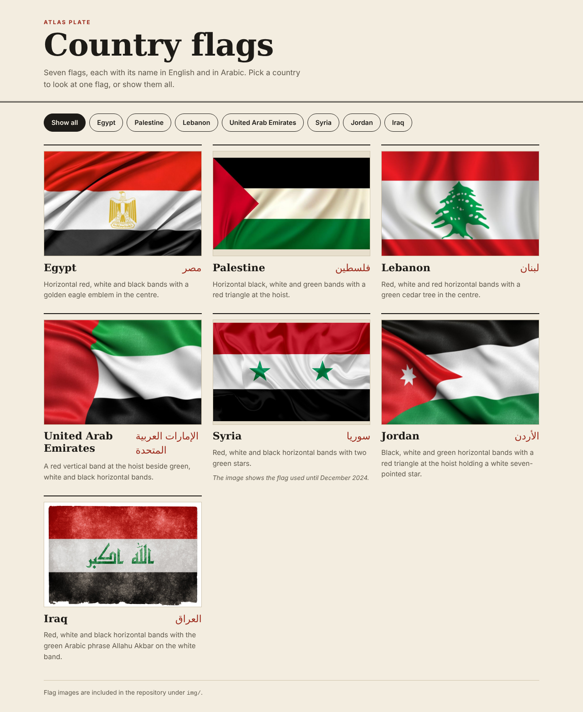
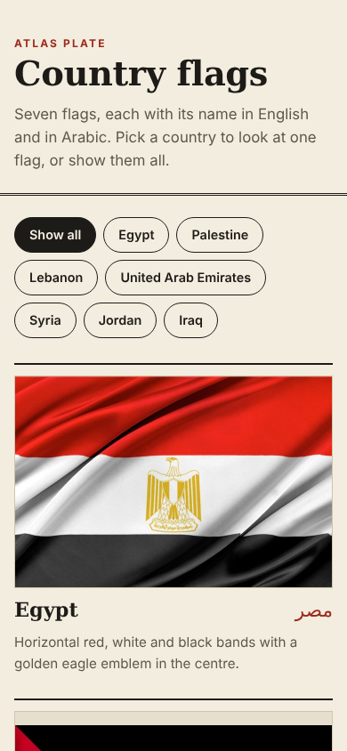

# Country Flags

A small, responsive page showing seven country flags (Egypt, Palestine, Lebanon, United Arab Emirates, Syria, Jordan, Iraq) with each country name in English and Arabic. Choose a country to look at one flag, or show them all. Plain HTML, CSS and JavaScript, no build step, no dependencies, no CDN.

Live demo: https://simple-countries-flages.vercel.app





## What it does

- Responsive grid of flag cards. Images are lazy-loaded, have explicit `width` and `height` (no layout jump) and alt text.
- Filter buttons (`aria-pressed`) show one country or all. The selection is reflected in the URL hash, for example `/#jordan`.
- Without JavaScript all flags are simply visible.
- Arabic names are marked up with `lang="ar" dir="rtl"` so screen readers pronounce them correctly and the text is laid out right-to-left inside the otherwise left-to-right English page.
- Respects `prefers-reduced-motion`. System fonts only.

## What changed from the original

- The original page only had English labels and Lorem ipsum. The Arabic in the original repo was in the image filenames only. Those files were renamed to ASCII names (`egypt.jpg`, `lebanon.jpg`, `uae.jpg`, `jordan.jpg`, `palestine.jpg`, `syria.png`, `iraq.jpg`) because they were referenced only from `index.html`. The image contents were not touched.
- The Arabic country names on the page are new text added in this version. Please check them.
- The Syria, Jordan and Iraq images were already in `img/` but were not used. They are now shown.
- The Lorem ipsum was replaced by short factual descriptions of what each flag image shows.

## Run it

```sh
python3 -m http.server 5264
# open http://localhost:5264
```

## Verification

Headless Chromium (Playwright) at 1280x800 and 390x844: all 7 cards and 8 filter buttons render, filtering and the "Show all" button work, deep link `/#iraq` works, all images have `loading="lazy"` and alt text, no failed requests, no console errors, no horizontal scroll on mobile. There are no automated tests in the repo.

## Known limitations

- The Syria image shows the flag that was used until December 2024. It is labelled as such on the page. Swap `img/syria.png` if you want the current flag.
- Flag images were already in the repo; their original sources and licences are not documented. Check their licences before reusing this beyond a demo.
- Flags are shown with `object-fit: contain`, so images with a different aspect ratio get a small tinted margin.

## Notes

UI and code quality improvements were made with AI assistance (Claude, Anthropic), reviewed and verified by building and running the app.
